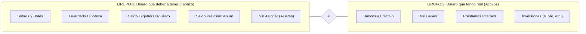

# Auditoría Técnica, Funcional y Contable — Flow Finanzas

> **Fecha:** 21 de Noviembre de 2026  
> **Modo de Auditoría:** Solo lectura (sin modificación de código)  
> **Objetivo:** Detección de fallos latentes, bloqueos de interfaz, enlaces rotos u ocultos y análisis de arquitectura contable.

---

## Resumen Ejecutivo

La aplicación presenta una arquitectura moderna y sólida (FastAPI + SQLite + Vanilla JS modular reactivo con estética Glassmorphism). Tras resolver los problemas de **archivado seguro de sobres** y la **edición de cuentas bancarias en movimientos**, se ha realizado un escaneo exhaustivo de extremo a extremo de todos los módulos.

Se han identificado **3 áreas clave de mejora**:
1. **Fallos silenciosos en formularios** (donde la interfaz muestra campos pero el servidor los ignora, idéntico al que ocurría con la cuenta bancaria).
2. **Movimientos de inversión que pueden provocar descuadres**.
3. **Puntos ciegos de navegación y UX** (enlaces sin acceso directo en los menús y uso de diálogos nativos `prompt()` del navegador).

---

## 1. Fallos Funcionales y Silenciosos (Bugs Latentes)

### 🔴 1.1. Edición de Deudas («Me deben») ignora el importe y la fecha
* **Ubicación:** `app_conta/static/js/modales-acciones.js` (línea 2772) vs `app_conta/api/deudas.py` (línea 45).
* **Descripción:**  
  En el modal `abrirModalEditarDeuda`, el usuario dispone de un campo editable para modificar el **Importe total original (€)** (`#ed-importe`) y la **Fecha del apunte** (`#ed-fecha`). El formulario envía `{ deudor, concepto, importe_total, fecha }` mediante `PATCH /deudas/{id}`.
* **El fallo:**  
  En el backend, el modelo `DeudaPatch` únicamente define:
  ```python
  class DeudaPatch(BaseModel):
      deudor: str | None = None
      concepto: str | None = None
      fecha_limite: str | None = None
      notas: str | None = None
  ```
  Al tener `extra="ignore"`, FastAPI descarta silenciosamente `importe_total` y `fecha`. La función `editar_deuda` nunca los actualiza.
* **Impacto:** Si corriges el importe de una deuda porque te equivocaste al meterla, el sistema te dice que se ha guardado, pero el dinero que te deben sigue siendo el valor antiguo, afectando al total del grupo "Me deben" y al cuadre general.

---

### 🔴 1.2. Aportaciones y Reembolsos en Inversiones descuadran la Conciliación
* **Ubicación:** `app_conta/services/inversiones.py` (líneas 194 y 235) vs `app_conta/services/conciliacion.py` (línea 101).
* **Descripción:**  
  Al registrar una aportación a una inversión (ej. mandar 500 € a eToro/Indexa desde Caixa) o un reembolso (retirar 500 € al banco), se crea un apunte bancario con `bote_id = None`:
  * Aportación: `Movimiento(-500 €, "Aportación inversión: eToro")`
  * Reembolso: `Movimiento(+500 €, "Reembolso inversión: eToro")`
* **El fallo:**  
  En `conciliacion.py`, la variable `sin_asignar` suma todos los movimientos con `bote_id is None`. Aunque ya excluimos los adelantos de deudas y las facturas de previsión, **los movimientos de inversión no están excluidos**.
* **Impacto:**
  Mover dinero entre el Banco y la Inversión es un traspaso interno de activos dentro del Grupo 2 (Dinero Real). Al no excluirse de `sin_asignar`, el sistema resta el importe en el Grupo 1 (Dinero Teórico), provocando un **descuadre inmediato por el importe exacto de la aportación o reembolso**.

---

### 🟡 1.3. Al archivar una Categoría se desvinculan los movimientos históricos
* **Ubicación:** `app_conta/services/categorias.py` (líneas 163-165).
* **Descripción:**
  ```python
  for mov in movimientos:
      mov.categoria_id = None
  categoria.archivada = True
  ```
* **Impacto:** Al igual que ocurría antes con los botes, archivar una categoría que ya no se usa borra la etiqueta de categoría de todos los gastos pasados, dejando esos movimientos huérfanos de categoría en los informes analíticos en lugar de preservar su histórico.

---

## 2. Navegación, Enlaces y Usabilidad (UX)

### 🟡 2.1. Vistas Huérfanas / Ocultas en la Interfaz
| Vista | Archivo | Estado de Navegación |
|---|---|---|
| **Importar Excel** (`/importar`) | `views/importar.js` | 🔴 **Oculta:** Está programada y registrada, pero no existe ningún enlace ni botón en toda la app para entrar a ella. Solo se puede acceder tecleando la URL manualmente en el navegador. |
| **Fondo Hipoteca** (`/ahorro`) | `views/ahorro.js` | 🟡 **Parcial:** No aparece en el menú desplegable "Más" (`ITEMS_MAS`). Solo se puede acceder si estás dentro de `/botes` o `/deben` a través de las pestañas superiores. |
| **Tarjetas** (`/tarjetas`) | `views/tarjetas.js` | 🟡 **Parcial:** No aparece en el menú "Más". Se accede desde las pestañas de Cuentas o si no hay tarjetas en Pagos Diarios. |

---

### 🟡 2.2. Botón "Cargar más movimientos" no desaparece al terminar
* **Ubicación:** `app_conta/static/js/app.js` (línea 403) vs `app_conta/static/js/views/movimientos.js` (línea 430).
* **Descripción:**  
  Al pulsar "Cargar más movimientos", `app.js` comprueba si ya se han cargado todos los movimientos con:
  ```javascript
  if (offset + data.items.length >= data.total) btn.closest(".fila-acciones")?.remove();
  ```
  Sin embargo, en `movimientos.js` el botón está dentro de un `<div style="text-align: center; ...">` que no tiene la clase `.fila-acciones`.
* **Impacto:** El botón nunca se elimina del pie de página cuando ya no quedan más registros por mostrar.

---

### 🟡 2.3. Uso de cadenas de `prompt()` nativos en móviles
* **Ubicación:** `app_conta/static/js/app.js` (líneas 663-672 y 769-775).
* **Descripción:**
  * **Modificar Gasto Recurrente:** Abre **5 ventanas emergentes seguidas** (`prompt()` del navegador para concepto, fecha, importe anual, cuota y notas).
  * **Modificar Préstamo:** Abre 2 ventanas `prompt()` consecutivas.
  * **Editar Categoría:** Abre 1 ventana `prompt()`.
* **Impacto:** En dispositivos móviles o en la PWA instalada, los diálogos nativos del navegador se cancelan si recibes una llamada, una notificación o tocas fuera, perdiendo los datos ya introducidos. Conviene sustituirlos por modales con diseño Fintech (como el que creamos hoy para pagar recibos).

---

## 3. Arquitectura Contable y Cuadre de Saldos



### Diagnóstico de la Identidad Contable:
1. **Préstamos Internos:**  
   Los préstamos de la base de datos (`Coche Hyundai` y `Ciclo DAM`) tienen como entidad *"Bote ahorro"*. Se comportan como dinero adelantado desde un sobre de reserva. En la fórmula suman al Grupo 2 como activo pendiente de recuperar, lo cual es coherente con tu planteamiento.
2. **Cuenta 3 («Reserva Botes Históricos»):**  
   Esta cuenta virtual archivada contiene los 22.104,53 € de apertura de los sobres importados del Excel. No figura en bancos activos, por lo que los botes dependen de que sus movimientos no se desliguen a "sin asignar" (lo cual quedó blindado en la sesión de hoy).
3. **Estado Actual:**  
   La diferencia técnica de conciliación está en **+0,72 €**, dentro de la tolerancia de redondeo de 1,00 €, con el estado oficial **«Contabilidad al día» (Cuadrado)**.

---

## Conclusiones y Próximos Pasos Sugeridos

| Prioridad | Tarea | Beneficio |
|---|---|---|
| **Alta** | Habilitar `importe_total` y `fecha` en `DeudaPatch` | Poder editar cualquier error en "Me deben" sin que el servidor lo ignore. |
| **Alta** | Excluir aportaciones/reembolsos de inversión en `sin_asignar` | Evitar descuadres al transferir dinero entre banco e inversiones. |
| **Media** | Enlazar `/importar` en el menú "Más" | Tener acceso directo a la herramienta de importación de extractos. |
| **Media** | Reemplazar los 5 `prompt()` de Previsión por un modal | Experiencia de usuario uniforme y sin fallos en móviles. |
