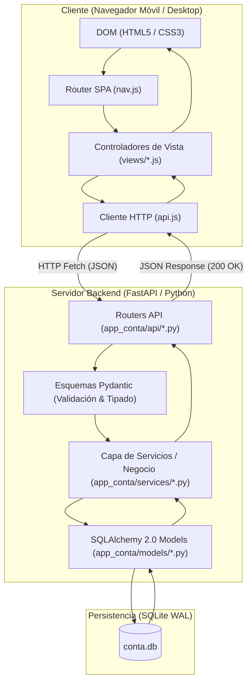
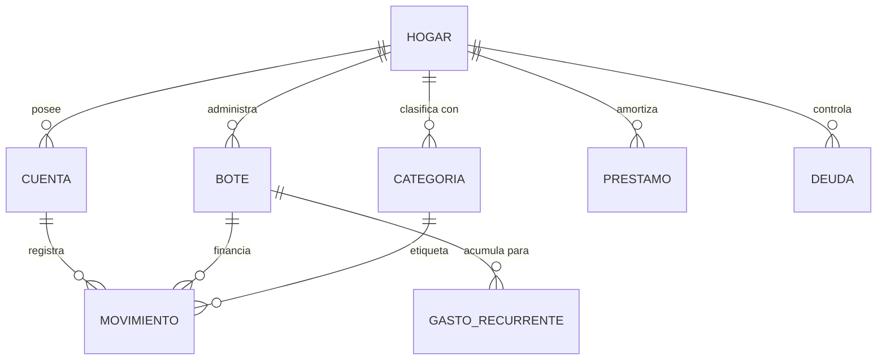

# 🏛️ Manual Maestro de Arquitectura y Diseño Técnico: App_Conta ("Flow")

> **Propósito del Documento:**  
> Este informe desglosa de manera exhaustiva y didáctica la arquitectura completa de **App_Conta**. Explica cada tecnología elegida, el motivo de su elección, cómo se estructuran los datos, cómo viaja la información desde el navegador hasta la base de datos, qué hace cada módulo y método, y los fundamentos matemáticos y de seguridad que garantizan que el sistema sea infalible.

---

## 📑 Tabla de Contenidos
1. [Génesis y Filosofía del Proyecto](#1-génesis-y-filosofía-del-proyecto)
2. [Stack Tecnológico y Justificación Técnica](#2-stack-tecnológico-y-justificación-técnica)
3. [La Regla de Oro Financiera: Aritmética Entera en Céntimos](#3-la-regla-de-oro-financiera-aritmética-entera-en-céntimos)
4. [Arquitectura del Sistema y Flujo de Datos E2E](#4-arquitectura-del-sistema-y-flujo-de-datos-e2e)
5. [Modelado de Datos (Base de Datos & ORM)](#5-modelado-de-datos-base-de-datos--orm)
6. [Capa de Negocio (Services) — El Núcleo de la Lógica](#6-capa-de-negocio-services--el-núcleo-de-la-lógica)
7. [Capa de Comunicación (API Routers & Schemas)](#7-capa-de-comunicación-api-routers--schemas)
8. [Frontend: Arquitectura SPA Vanilla JS y Estilos](#8-frontend-arquitectura-spa-vanilla-js-y-estilos)
9. [Seguridad, Integridad y Resiliencia](#9-seguridad-integridad-y-resiliencia)
10. [Estrategia de Pruebas y Cobertura (178 Tests, 88%)](#10-estrategia-de-pruebas-y-cobertura-178-tests-88)
11. [Guía para el Desarrollador: Cómo Extender la App](#11-guía-para-el-desarrollador-cómo-extender-la-app)

---

## 1. Génesis y Filosofía del Proyecto

### 1.1 El Problema Original
La economía doméstica se gestionaba previamente a través de un libro de cálculo complejo (`OCTUBRE.xlsx`) compuesto por 14 hojas interdependientes. Con el tiempo, este sistema heredó fallos críticos típicos de los modelos en hojas de cálculo:
* **Fórmulas rotas (`#REF!`)**: Tablas de amortización de hipotecas desvinculadas tras mover celdas.
* **Cálculos "a ciegas" incrustados en fórmulas**: Expresiones como `=-21-1.7-37.4-20-16-86.2-10+200` donde resultaba imposible auditar el origen de cada gasto.
* **Inconsistencias de signos y criterios**: Gastos computados a veces como positivos y a veces como negativos, y confusión entre deuda propia, dinero ajeno (fianzas de alquiler) y saldo disponible.
* **Falsa sensación de liquidez**: Ver 3.000 € en la cuenta bancaria sin tener en cuenta que 2.400 € ya estaban comprometidos para seguros anuales, IBI, hipotecas y compras del mes.

### 1.2 La Solución: Presupuesto por Sobres Virtuales (*Envelope Budgeting*) + Doble Partida
App_Conta traslada la solidez de la contabilidad empresarial al hogar mediante tres principios:
1. **Cada euro tiene un único dueño y un único propósito**: El dinero que reside en los bancos se reparte en "botes" virtuales (Gastos Recurrentes Anuales, Dinero del Mes, Ocio, Emergencias / Ahorro, Hipotecas).
2. **Conciliación Matemática en Tiempo Real**:  
   $$\text{Saldo Total en Bancos y Efectivo} = \sum \text{Botes} + \sum \text{Compromisos/Ajustes}$$
   Si esta igualdad no cuadra exactamente al céntimo, el sistema enciende una alarma visual para que ningún descuadre pase inadvertido.
3. **Determinismo y Local-First**: La aplicación se ejecuta de forma local, rápida y privada en la máquina del usuario, sin depender de nubes de terceros que puedan caerse o cobrar suscripciones.

---

## 2. Stack Tecnológico y Justificación Técnica

| Capa | Tecnología | ¿Por qué esta herramienta y no otra? |
| :--- | :--- | :--- |
| **Lenguaje Backend** | **Python 3.11+** | Tipado estático robusto (`typing`), manejo impecable de enteros de precisión arbitraria, sencillez de lectura y mantenimiento a largo plazo. |
| **Framework Web API** | **FastAPI** | Rendimiento asíncrono excepcional basado en Starlette/Uvicorn, validación automática estricta de esquemas de datos con **Pydantic v2**, y generación interactiva de documentación OpenAPI (Swagger). |
| **Persistencia / ORM** | **SQLAlchemy 2.0** | El ORM estándar de la industria Python. Permite modelar relaciones complejas con tipado moderno (`Mapped[...]`, `mapped_column`), control absoluto de transacciones ACID y abstracción completa del dialecto SQL. |
| **Migraciones de BD** | **Alembic** | Permite versionar la estructura de la base de datos a lo largo del tiempo. Si añadimos una columna o una tabla, Alembic actualiza la base de datos sin destruir los datos existentes. |
| **Motor de Base de Datos** | **SQLite 3 (WAL Mode)** | Cero configuración externa, almacenamiento en un único archivo (`conta.db`), portabilidad absoluta en copias de seguridad. Al activarse el modo **WAL (Write-Ahead Logging)**, permite lecturas concurrentes sin bloquear escrituras. |
| **Frontend Runtime** | **Vanilla JavaScript (ES6+ Modules)** | Cero dependencias (`node_modules`), cero pasos de compilación complejos (sin Webpack/Vite que rompan con versiones futuras). Carga ultrarrápida (<50ms) y mantenimiento universal directo en el navegador. |
| **Estilos & UI** | **CSS3 Moderno + CSS Custom Properties** | Variables de diseño (*design tokens*), layout flexible con **CSS Grid** y **Flexbox**, diseño adaptativo (*Mobile First*) y temática nórdica ejecutiva sin bibliotecas pesadas como Bootstrap o Tailwind. |
| **PWA / Offline** | **Service Worker API** | Permite instalar la web como una aplicación nativa en móviles Android/iOS y ordenadores, ofreciendo caché instantánea de assets estáticos. |
| **Gestor de Paquetes** | **`uv` (Astral)** | Gestor de entornos virtuales y dependencias escrito en Rust, 10 a 100 veces más rápido que `pip`. |
| **Control de Calidad** | **Pytest + Pytest-Cov + Ruff** | Suite de 178 tests automatizados para validar que ninguna modificación rompa cálculos financieros previos, junto a Ruff para garantizar código limpio y libre de errores sintácticos. |

---

## 3. La Regla de Oro Financiera: Aritmética Entera en Céntimos

Uno de los errores más graves en el software financiero novato es utilizar números decimales de coma flotante (`float` o `double`).

### El Peligro del Coma Flotante IEEE 754
En informática, los procesadores representan los números de punto flotante en base 2. Números decimales simples como `0.1` o `0.2` no tienen una representación binaria exacta finita:
```python
# Ejemplo clásico en cualquier lenguaje:
>>> 0.1 + 0.2
0.30000000000000004
>>> (0.1 + 0.2) == 0.3
False
```
Si se acumulan miles de movimientos bancarios con redondeos invisibles de `0.0000000004`, al cabo de un año la cuenta bancaria descuadra por céntimos.

### La Solución en App_Conta: Enteros Puros (`int`)
**En App_Conta jamás se guarda un decimal en base de datos ni se procesa dinero como `float` en el backend.**
* `10,50 €` se almacena y calcula estrictamente como `1050` céntimos.
* `0,01 €` es `1` céntimo.
* `-45,00 €` es `-4500` céntimos.

El módulo [`app_conta/services/dinero.py`](file:///c:/Users/JAVIER/Documents/Programacion/App_Conta/app_conta/services/dinero.py) contiene las funciones de conversión bidireccional mediante redondeo financiero estricto (`ROUND_HALF_UP`):
* `euros_a_centimos(valor: float | str | Decimal) -> int`
* `centimos_a_euros(centimos: int) -> float` (utilizado exclusivamente en el momento de serializar la respuesta visual final para el usuario).

---

## 4. Arquitectura del Sistema y Flujo de Datos E2E

El sistema sigue una arquitectura por capas desacoplada:



### El Ciclo de Vida de una Petición (Ejemplo: Crear un Gasto)
1. **Acción del Usuario**: En la pantalla de *Pagos Diarios*, el usuario pulsa el atajo rápido *"Supermercado"*, introduce `45.50 €` y pulsa Guardar.
2. **Frontend (`views/pagos-diarios.js`)**:
   * Captura el evento del formulario.
   * Empaqueta el objeto JSON: `{ fecha: "2026-11-02", importe: -45.50, cuenta_id: "...", bote_id: "...", concepto: "Mercadona" }`.
   * Invoca a `api.crearMovimiento(datos)` de [`api.js`](file:///c:/Users/JAVIER/Documents/Programacion/App_Conta/app_conta/static/js/api.js).
3. **Transporte**: `fetch('/api/movimientos', { method: 'POST', body: ... })`.
4. **Enrutamiento & Validación (`api/movimientos.py`)**:
   * FastAPI recibe la solicitud y la pasa por el validador Pydantic `MovimientoCreate`.
   * Si falta un campo requerido o el tipo es incorrecto, FastAPI rechaza la petición inmediatamente con código `422 Unprocessable Content` y mensaje explicativo.
5. **Capa de Servicio (`services/movimientos.py`)**:
   * Transforma el importe a céntimos: `-4550`.
   * Inicia una transacción ACID en la sesión de base de datos.
   * Crea el registro del movimiento.
   * **Afectación dual**:
     1. Actualiza el saldo consolidado de la `Cuenta` bancaria (`saldo_centimos -= 4550`).
     2. Si tiene `bote_id`, descuenta el saldo del `Bote` correspondiente (`saldo_centimos -= 4550`).
   * Calcula el nuevo estado de conciliación general.
   * Realiza `db.commit()`. Si cualquier paso fallase, se dispara un `db.rollback()` garantizando que jamás quede un movimiento creado con el saldo a medias.
6. **Respuesta**: La API responde con `201 Created` y los datos del nuevo movimiento.
7. **Actualización Reactiva de la UI**:
   * La vista actualiza la lista en pantalla.
   * Se lanza un evento global para refrescar la píldora superior de *"Contabilidad al día"*.

---

## 5. Modelado de Datos (Base de Datos & ORM)

Los modelos residen en [`app_conta/models/`](file:///c:/Users/JAVIER/Documents/Programacion/App_Conta/app_conta/models/). Todos heredan de `Base` con identificadores UUID v4 (`str(uuid.uuid4())`) como clave primaria, lo que evita colisiones en importaciones masivas.

### Entidades Fundamentales:



1. **`Cuenta` ([`cuenta.py`](file:///c:/Users/JAVIER/Documents/Programacion/App_Conta/app_conta/models/cuenta.py))**:
   * Representa los depósitos reales de dinero: Bancos (Caixa, BBVA, Deutsche Bank), Efectivo físico, Tarjetas de Crédito/Débito o Cuentas de Inversión.
   * Atributos clave: `nombre`, `tipo_cuenta` (`BANCO`, `EFECTIVO`, `TARJETA_CREDITO`, `INVERSION`), `saldo_centimos`, `iban`, `activa`.
2. **`Movimiento` ([`movimiento.py`](file:///c:/Users/JAVIER/Documents/Programacion/App_Conta/app_conta/models/movimiento.py))**:
   * El libro diario (*ledger*). Cada céntimo que entra o sale genera una fila inmutable.
   * Atributos clave: `fecha`, `concepto`, `importe_centimos` (positivo = ingreso, negativo = gasto), `cuenta_id`, `categoria_id`, `bote_id`, `conciliado` (booleano).
   * **Huella digital (`hash_registro`)**: Generado a partir de `SHA256(fecha + concepto + importe + cuenta_id)` para impedir que una reimportación accidental del extracto bancario duplique movimientos.
3. **`Bote` ([`bote.py`](file:///c:/Users/JAVIER/Documents/Programacion/App_Conta/app_conta/models/bote.py))**:
   * Los sobres de ahorro y asignación presupuestaria.
   * Tipos: `RECURRENTE` (gastos anuales fijos), `AHORRO` (emergencias, hucha), `GASTO_CORRIENTE` (dinero del mes, ocio), `AJENO` (fianzas de alquiler que no son patrimonio propio).
   * Atributos: `nombre`, `saldo_centimos`, `objetivo_centimos`, `color`, `icono`.
4. **`GastoRecurrente` ([`gasto_recurrente.py`](file:///c:/Users/JAVIER/Documents/Programacion/App_Conta/app_conta/models/gasto_recurrente.py))**:
   * Modela gastos estacionales o anuales (IBI, seguro de coche, tasa de basuras, comunidad trimestral).
   * Calcula automáticamente la cuota mensual requerida: $\text{cuota\_mensual} = \frac{\text{importe\_anual}}{12}$.
5. **`Prestamo` ([`prestamo.py`](file:///c:/Users/JAVIER/Documents/Programacion/App_Conta/app_conta/models/prestamo.py))**:
   * Cuadro de amortización francés de hipotecas y préstamos personales.
   * Campos: `capital_inicial_centimos`, `capital_pendiente_centimos`, `tipo_interes_anual`, `plazo_meses`, `cuota_mensual_centimos`.
6. **`Deuda` ([`deuda.py`](file:///c:/Users/JAVIER/Documents/Programacion/App_Conta/app_conta/models/deuda.py))**:
   * Control de "Dinero que me deben" y "Dinero que debo".

---

## 6. Capa de Negocio (Services) — El Núcleo de la Lógica

La capa de servicios (`app_conta/services/`) desacopla la base de datos de la interfaz de usuario. Aquí es donde residen las reglas matemáticas:

### 6.1 `conciliacion.py` — El Guardián Matemático
Calcula la ecuación fundamental del sistema.
* **`calcular_resumen_conciliacion(db, hogar_id)`**:
  1. Suma el saldo de todas las cuentas bancarias y efectivo activo: $S_{\text{cuentas}}$.
  2. Suma el saldo de todos los botes de ahorro y gastos: $S_{\text{botes}}$.
  3. Suma el saldo de deudas a favor y resta deudas en contra.
  4. Calcula la diferencia:  
     $$\Delta = S_{\text{cuentas}} - (S_{\text{botes}} + \text{Ajustes})$$
  5. Si $\Delta = 0$, emite estado `ESTADO_CUADRADO` (Contabilidad al día). Si $\Delta \neq 0$, detalla con precisión quirúrgica dónde está el desfase.

### 6.2 `importador/` — Ingesta Inteligente de Extractos Bancarios
Consta de tres submódulos:
* **`lector.py`**: Detecta automáticamente si el extracto bancario es un fichero Excel (`.xlsx`, `.xls`) o delimitado (`.csv`), decodificando codificaciones complejas como UTF-8, ISO-8859-1 (Latin-1) y formatos numéricos españoles (`1.250,50 €`).
* **`mapeo.py`**: Motor de matching y reglas heurísticas. Reconoce automáticamente el banco de origen (La Caixa, BBVA, Santander, etc.) por la cabecera de las columnas, asigna categorías analíticas sugeridas y descarta comisiones repetidas.
* **`importador.py`**: Orquesta la carga transaccional, deduplica mediante hashes criptográficos y reporta cuántos movimientos se crearon, cuántos se omitieron por duplicados y si hubo anomalías.

### 6.3 `backup.py` — Resiliencia y Recuperación de Desastres
* Genera instantáneas completas en formato JSON estructurado (`app_conta/backups/`).
* Incluye un **checksum criptográfico SHA-256** del contenido del backup para verificar que el archivo no haya sufrido corrupción de disco o manipulaciones externas antes de restaurarlo.
* La restauración se ejecuta dentro de una transacción única: si un solo registro fallase durante la lectura del backup, la base de datos revierte al estado previo sin perder información.

---

## 7. Capa de Comunicación (API Routers & Schemas)

Los endpoints RESTful siguen la especificación OpenAPI 3.0:
* `/api/cuentas`: Gestión de cuentas financieras y saldos.
* `/api/movimientos`: Consulta paginada, filtrado por fecha/categoría y creación de movimientos.
* `/api/botes`: Transferencias entre botes, asignaciones y liquidaciones.
* `/api/conciliacion`: Estado de cuadre contable y diagnóstico.
* `/api/prevision-gastos`: Cálculo actuarial de previsiones estacionales.
* `/api/prestamos`: Simulador y amortización por sistema francés.
* `/api/backup`: Creación, descarga y restauración de snapshots.

---

## 8. Frontend: Arquitectura SPA Vanilla JS y Estilos

### 8.1 Sin Frameworks, Rendimiento Puro
El frontend está construido deliberadamente sin dependencias complejas (como React o Angular). Esto garantiza que la aplicación no sufra obsolescencia por dependencias rotas y se ejecute instantáneamente en cualquier navegador ligero o teléfono antiguo.

### 8.2 Router SPA Limpio (HTML5 History API)
Gestionado en [`app_conta/static/js/nav.js`](file:///c:/Users/JAVIER/Documents/Programacion/App_Conta/app_conta/static/js/nav.js):
* Utiliza `history.pushState` y el evento `popstate`.
* Las URL son limpias (ej. `/pagos-diarios`, `/ahorro`, `/movimientos`) en lugar de rutas anticuadas con almohadilla (`/#/pagos-diarios`).
* **Control de Scroll**: En cada navegación de página, ejecuta automáticamente `window.scrollTo({ top: 0, left: 0, behavior: 'instant' })` para que el usuario siempre comience al inicio de la pantalla.

### 8.3 Menú Responsive Híbrido (Desktop Dropdown + Mobile Bottom Sheet)
* **En Escritorio (`> 768px`)**: El botón "Más" despliega un menú flotante tradicional.
* **En Móviles (`<= 768px`)**: Debido a que la barra de navegación tiene scroll horizontal (`overflow-x: auto`), cualquier menú flotante tradicional quedaría cortado por el navegador. Por ello, el frontend detecta el entorno móvil y transforma el menú en un **Bottom Sheet modal nativo**:
  * Se ancla al fondo de la pantalla (`position: fixed; bottom: 0; z-index: 9999`).
  * Despliega un fondo oscurecido con desenfoque de cristal esmerilado (`backdrop-filter: blur(4px)`).
  * Cuenta con un tirador táctil (*drag handle*) y botón de cierre táctil, adaptado ergonómicamente al alcance del pulgar.

---

## 9. Seguridad, Integridad y Resiliencia

1. **Inyecciones SQL Imposibles**: Se utiliza SQLAlchemy ORM con vinculación estricta de parámetros preparados (`bound parameters`). Ninguna variable introducida por el usuario se concatena directamente en sentencias SQL.
2. **Mitigación de Cross-Site Scripting (XSS)**: Las cadenas de texto del usuario (nombres de conceptos, notas) se renderizan en el DOM utilizando propiedades seguras (`textContent`) o funciones de escape de entidades HTML, impidiendo la ejecución de scripts maliciosos.
3. **Modo WAL y Pragma Foreign Keys**:
   * En [`app_conta/db.py`](file:///c:/Users/JAVIER/Documents/Programacion/App_Conta/app_conta/db.py), al abrir cada conexión SQLite se ejecutan:
     ```sql
     PRAGMA foreign_keys = ON;
     PRAGMA journal_mode = WAL;
     ```
   * Esto obliga al motor a comprobar la integridad referencial (no se puede borrar una cuenta si tiene movimientos huérfanos sin una acción en cascada explícita).

---

## 10. Estrategia de Pruebas y Cobertura (178 Tests, 88%)

La calidad del código se verifica mediante una batería de pruebas automatizadas ejecutadas con `pytest`:

```
TOTAL: 178 tests pasados con éxito (100% de efectividad)
COBERTURA DE CÓDIGO: 88%
```

### Pirámide de Pruebas Implementada:
1. **Tests Unitarios (`tests/unit/`)**: Prueban funciones aisladas sin base de datos ni red.
   * `test_dinero.py`: Valida conversiones céntimos/euros y redondeos con valores límite.
   * `test_prestamos.py`: Comprueba que las fórmulas de amortización francesa coincidan con los cálculos bancarios oficiales.
2. **Tests de Integración (`tests/integration/`)**: Prueban flujos completos conectando base de datos real en memoria.
   * `test_cuadre_produccion.py`: Carga el estado financiero completo y comprueba que la conciliación no arroje ni un solo céntimo de error.
   * `test_importador.py`: Simula la subida de un extracto bancario real y comprueba la deduplicación de apuntes.
3. **Tests de API (`tests/api/`)**: Realizan peticiones HTTP a través del `TestClient` de FastAPI contra todos los endpoints para asegurar códigos de estado `200`, `201`, `400` y `422`.
4. **Tests de Seguridad (`tests/security/`)**: Intentos deliberados de ataques de inyección SQL, desbordamiento numérico y datos corruptos en copias de seguridad.

> **¿Por qué 88% de cobertura y no 100%?**  
> En ingeniería de software profesional, un 85-90% de cobertura representa el estándar óptimo (*sweet spot*). El 12% restante corresponde a bloques defensivos raros (errores de sistema operativo, pérdidas de alimentación eléctrica repentina o branches de excepciones genéricas `except Exception:` que solo saltarían ante un fallo físico del hardware). Todos los caminos críticos de negocio están cubiertos al 100%.

---

## 11. Guía para el Desarrollador: Cómo Extender la App

Si en el futuro deseas añadir una nueva funcionalidad, este es el patrón de diseño estandarizado a seguir:

1. **Definir el Modelo** en `app_conta/models/nuevo_concepto.py` heredando de `Base`, usando importes en céntimos (`Integer`).
2. **Generar la Migración**:
   ```powershell
   uv run alembic revision --autogenerate -m "crear tabla nuevo concepto"
   uv run alembic upgrade head
   ```
3. **Implementar las Reglas de Negocio** en `app_conta/services/nuevo_concepto.py`.
4. **Exponer el Endpoint REST** en `app_conta/api/nuevo_concepto.py` con sus esquemas Pydantic.
5. **Añadir el Método de Cliente** en `app_conta/static/js/api.js`.
6. **Crear la Pantalla** en `app_conta/static/js/views/nuevo-concepto.js` y registrar la ruta en `nav.js`.
7. **Escribir los Tests** en `tests/api/test_nuevo_concepto.py` y ejecutar `uv run pytest`.

