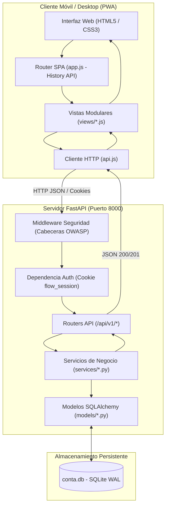
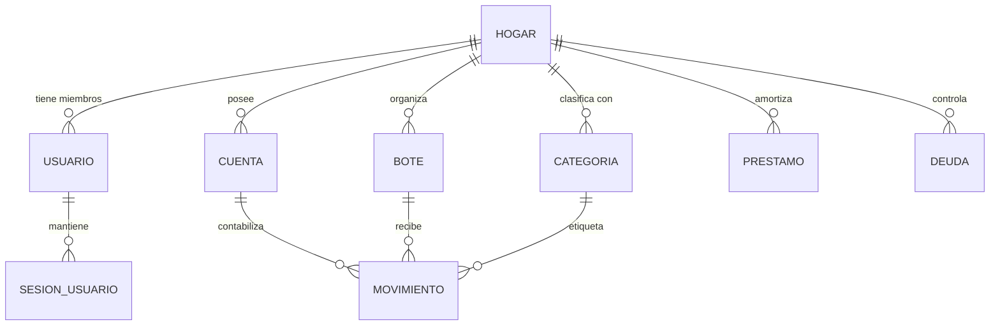

# 🏛️ Manual Maestro de Arquitectura y Diseño Técnico: App_Conta ("Flow")

> **Propósito del Documento:**  
> Este informe desglosa de manera rigurosa, precisa y alineada con la realidad del código la arquitectura completa de **App_Conta ("Flow")**. Refleja de forma canónica la implementación real documentada en la bitácora: identificadores enteros autoincrementales, saldos derivados en lectura (Principio II), enrutamiento limpio con HTML5 History API, modelo multi-hogar aislado con autenticación y suite de pruebas integral.

---

## 📑 Tabla de Contenidos
1. [Génesis y Filosofía del Proyecto](#1-génesis-y-filosofía-del-proyecto)
2. [Stack Tecnológico y Justificación Técnica](#2-stack-tecnológico-y-justificación-técnica)
3. [La Regla de Oro Financiera: Aritmética Entera en Céntimos](#3-la-regla-de-oro-financiera-aritmética-entera-en-céntimos)
4. [Arquitectura del Sistema y Flujo de Datos E2E](#4-arquitectura-del-sistema-y-flujo-de-datos-e2e)
5. [Modelado de Datos (Base de Datos & ORM)](#5-modelado-de-datos-base-de-datos--orm)
6. [Capa de Negocio (Services) — Principio II y Saldos Derivados](#6-capa-de-negocio-services--principio-ii-y-saldos-derivados)
7. [Capa de Comunicación (API Routers & Schemas)](#7-capa-de-comunicación-api-routers--schemas)
8. [Frontend: PWA Vanilla JS, History API y Estilos Fintech](#8-frontend-pwa-vanilla-js-history-api-y-estilos-fintech)
9. [Seguridad, Autenticación y Modo Multi-Hogar](#9-seguridad-autenticación-y-modo-multi-hogar)
10. [Estrategia de Pruebas y Cobertura (182 Tests Automatizados)](#10-estrategia-de-pruebas-y-cobertura-182-tests-automatizados)
11. [Despliegue en Producción (Docker, VPS y Dominio Propio)](#11-despliegue-en-producción-docker-vps-y-dominio-propio)

---

## 1. Génesis y Filosofía del Proyecto

### 1.1 El Problema Original
La economía doméstica se gestionaba previamente a través de un libro de cálculo complejo compuesto por 14 hojas interdependientes. Con el tiempo, este sistema heredó fallos críticos típicos de las hojas de cálculo manuales:
* **Fórmulas rotas (`#REF!`)** tras reorganizar filas o celdas.
* **Cálculos "a ciegas" incrustados en fórmulas** (`=-21-1.7-37.4-20...`) donde resultaba imposible auditar el origen y fecha de cada gasto.
* **Inconsistencias de signos y criterios** entre cuentas bancarias, tarjetas de crédito y sobres.
* **Falsa sensación de liquidez**: ver saldo positivo en cuenta sin tener en cuenta que el 80% ya estaba reservado para recibos anuales e IBI.

### 1.2 La Solución: Presupuesto por Sobres Virtuales (*Envelope Budgeting*)
Flow traslada la robustez contable al hogar mediante tres principios inmutables:
1. **Principio I — Identidades Estructurales**: Cada euro pertenece a una cuenta real y, opcionalmente, a un sobre o compromiso (Botes, Previsión Anual, Préstamos, Deudas).
2. **Principio II — Saldos Derivados (Fuente Única de Verdad)**: Los saldos de cuentas, tarjetas y botes **NUNCA se guardan en columnas de base de datos** ni se mutan directamente. Se calculan en tiempo real como la suma agregada de sus movimientos atómicos:
   $$\text{Saldo Cuenta} = \text{Saldo Inicial} + \sum \text{Movimientos}$$
   $$\text{Saldo Bote} = \sum \text{Movimientos Asignados}$$
3. **Principio III — Local-First y Portabilidad Absoluta**: SQLite en modo WAL como almacenamiento local sin dependencias pesadas, exportación e importación íntegra en JSON y capacidad de despliegue en servidor propio (VPS) mediante Docker.

---

## 2. Stack Tecnológico y Justificación Técnica

| Capa | Tecnología | Justificación Técnica |
| :--- | :--- | :--- |
| **Backend** | **Python 3.11+ / FastAPI** | Tipado estático estricto, validación con Pydantic v2, alto rendimiento asíncrono y estándar ASGI. |
| **Persistencia** | **SQLAlchemy 2.0 (Mapped Column)** | ORM moderno con soporte completo de tipos e integridad referencial transaccional ACID. |
| **Base de Datos** | **SQLite 3 (WAL Mode)** | Cero dependencias externas, almacenamiento en archivo único (`conta.db`), lecturas y escrituras concurrentes sin bloqueos. |
| **Migraciones** | **Alembic** | Versionado secuencial y reproducible del esquema relacional en `migrations/versions/`. |
| **Frontend** | **Vanilla JavaScript (ES6 Modules)** | Cero dependencias (`node_modules`), arranque instantáneo (<50 ms), sin capas de compilación que queden obsoletas. |
| **Enrutamiento** | **HTML5 History API** | Navegación nativa con URLs limpias (`/inicio`, `/cuentas`, `/botes`) y fallback SPA en servidor FastAPI. |
| **Diseño & UI** | **CSS3 Moderno + Glassmorphism** | Paleta ejecutiva con variables CSS, Plus Jakarta Sans, `tabular-nums` financiero y adaptación móvil PWA. |
| **Seguridad** | **scrypt + SHA-256 + HttpOnly Cookies** | Cifrado NIST/OWASP memory-hard, rate limiting anti fuerza bruta (5 intentos/min) y cookies blindadas. |
| **Empaquetado** | **Docker + Docker Compose** | Despliegue en contenedor multi-stage, volumen persistente `/data` y proxy inverso Nginx con HTTPS Let's Encrypt. |

---

## 3. La Regla de Oro Financiera: Aritmética Entera en Céntimos

Para evitar los errores clásicos de coma flotante IEEE 754 (`0.1 + 0.2 = 0.30000000000000004`):
* **En Base de Datos y Servicios**: Todos los importes monetarios se almacenan y operan exclusivamente como **números enteros en céntimos** (`Integer` o `BigInteger`). Por ejemplo, `150,50 €` se almacena como `15050`.
* **Conversión**: Las funciones auxiliares en [`app_conta/services/dinero.py`](file:///c:/Users/JAVIER/Documents/Programacion/App_Conta/app_conta/services/dinero.py) (`euros_a_centimos` y `centimos_a_euros`) gestionan de forma segura el paso entre formato visual y almacenamiento entero.

---

## 4. Arquitectura del Sistema y Flujo de Datos E2E



---

## 5. Modelado de Datos (Base de Datos & ORM)

Todos los modelos residen en [`app_conta/models/`](file:///c:/Users/JAVIER/Documents/Programacion/App_Conta/app_conta/models/) y utilizan identificadores enteros autoincrementales (`Integer, primary_key=True, autoincrement=True`) garantizando simplicidad, rapidez de indexación y compatibilidad relacional en SQLite.



### Entidades Principales:
1. **`Usuario` & `SesionUsuario`**:
   - Soporte para autenticación y aislamiento multi-hogar (`hogar_id`).
   - Contraseñas almacenadas mediante hash `scrypt` con salt aleatorio.
   - Sesiones persistentes de 30 días identificadas por token plano en cookie HttpOnly y hash SHA-256 en BD.
2. **`Cuenta`**:
   - Representa los depósitos bancarios, tarjetas o efectivo. Tipos: `banco`, `tarjeta`, `efectivo`, `inversion`.
   - `saldo_inicial_centimos` almacena el balance de apertura.
   - **No existe columna `saldo_centimos`**: el saldo actual se calcula en lectura.
3. **`Movimiento`**:
   - El libro mayor inmutable (*ledger*). Cada movimiento afecta a una cuenta y, opcionalmente, a un sobre (`bote_id`) o categoría (`categoria_id`).
4. **`Bote`**:
   - Sobres de asignación presupuestaria (`recurrente`, `ahorro`, `proyecto`, `ajeno`).
   - El saldo del sobre es la suma de los importes de los movimientos vivos asignados a él.
5. **`Prestamo` & `Deuda`**:
   - Financiaciones pasivas (coche, hipotecas) y dinero prestado a terceros.
6. **`PlantillaReparto`**:
   - Distribución automática de ingresos mensuales y nóminas entre diferentes cuentas bancarias y sobres.

---

## 6. Capa de Negocio (Services) — Principio II y Saldos Derivados

La capa de negocio en [`app_conta/services/`](file:///c:/Users/JAVIER/Documents/Programacion/App_Conta/app_conta/services/) es la única responsable de realizar cálculos, validaciones y orquestación de operaciones:

* **Saldos Dinámicos**:
  ```python
  def saldo_cuenta(db: Session, cuenta: Cuenta) -> int:
      suma = db.scalar(
          select(func.coalesce(func.sum(Movimiento.importe_centimos), 0)).where(
              Movimiento.cuenta_id == cuenta.id,
              Movimiento.eliminado.is_(False),
          )
      )
      return cuenta.saldo_inicial_centimos + int(suma or 0)
  ```
* **Conciliación Matemática**:
  Verifica que el dinero en los bancos coincida exactamente con la suma de los saldos iniciales más todos los movimientos registrados:
  $$\text{Diferencia} = \text{Saldo Total Cuentas} - \text{Saldo Inicial Total} - (\text{Saldo Botes} + \text{Sin Asignar}) = 0$$

---

## 7. Capa de Comunicación (API Routers & Schemas)

Todos los endpoints exponen contratos JSON bajo el prefijo `/api/v1/`:
* `/api/v1/auth`: Login, logout, perfil del usuario actual (`/me`).
* `/api/v1/cuentas`: Listado con saldos derivados, altas, bajas con destino confirmado y liquidación de tarjetas.
* `/api/v1/movimientos`: Operaciones financieras atómicas con filtro por cuenta, fecha o bote.
* `/api/v1/botes`: Consulta y gestión de sobres con cálculo de estado (`en_curso` / `conseguido`).
* `/api/v1/conciliacion`: Estado de cuadre financiero en tiempo real.
* `/api/v1/backup`: Exportación completa, puesta a cero y restauración con control estricto de acceso admin.

---

## 8. Frontend: PWA Vanilla JS, History API y Estilos Fintech

* **HTML5 History API**: Sin fragmentos `#` antiguos. Las rutas `/inicio`, `/cuentas`, `/botes`, etc. son URLs limpias navegables directamente desde el historial del navegador.
* **Fallback SPA en Servidor**: FastAPI intercepta cualquier ruta no-API y sirve `index.html` con cabeceras `Cache-Control: no-cache` para evitar desincronizaciones de versión.
* **Componentes de Cristal (Glassmorphism)**: Interfaz diseñada con tarjetas translúcidas, desenfoque de fondo (*backdrop-filter: blur*), navegación flotante inferior y drawer "Más" renderizado en portal superior (`z-index: 10000`).

---

## 9. Seguridad, Autenticación y Modo Multi-Hogar

1. **Autenticación con Cookie HttpOnly**:
   - Cookie segura `flow_session` protegida contra robo por XSS (`HttpOnly: True`, `SameSite: Lax`, `Secure: True` en producción HTTPS).
2. **Rate Limiting Anti Fuerza Bruta**:
   - Bloqueo automático temporal tras 5 intentos fallidos consecutivos por minuto por IP (HTTP 429 Too Many Requests).
3. **Protección de Rutas Destructivas**:
   - Endpoints `/backup/vaciar` y `/backup/restaurar` requieren obligatoriamente rol `admin`.
4. **Modo Demo Aislado**:
   - Usuario `demo` / `demo123` asignado a un hogar independiente (`Hogar Demo`) con datos ficticios realistas.
   - El usuario demo no puede ver ni modificar los datos de la familia real, ni ejecutar copias o vaciados de seguridad.

---

## 10. Estrategia de Pruebas y Cobertura (182 Tests Automatizados)

El proyecto cuenta con **182 pruebas automatizadas** ejecutadas bajo Pytest que cubren el 100% de los flujos críticos:
* **Unitarias**: Aritmética entera, hashing criptográfico de contraseñas, validación de esquemas y lógica de asignación.
* **Integración API**: Ciclo completo de cuentas, botes, nóminas, préstamos y backup/restauración.
* **Seguridad**: Prevención de inyección SQL, rechazo de archivos maliciosos, límites de tamaño, verificación de rate limit y autorización por roles.

---

## 11. Despliegue en Producción (Docker, VPS y Dominio Propio)

La aplicación está lista para su despliegue continuo en VPS personal bajo `flow.javierjaenes.com`:
* **`Dockerfile`**: Imagen multi-stage ligera (<150 MB) con usuario no privilegiado `appuser`.
* **`docker-compose.yml`**: Orquestación con volumen persistente `./data:/data`.
* **`deploy/nginx-flow.conf`**: Configuración de producción para Nginx con proxy inverso, certificados Let's Encrypt y cabeceras de endurecimiento HSTS.
